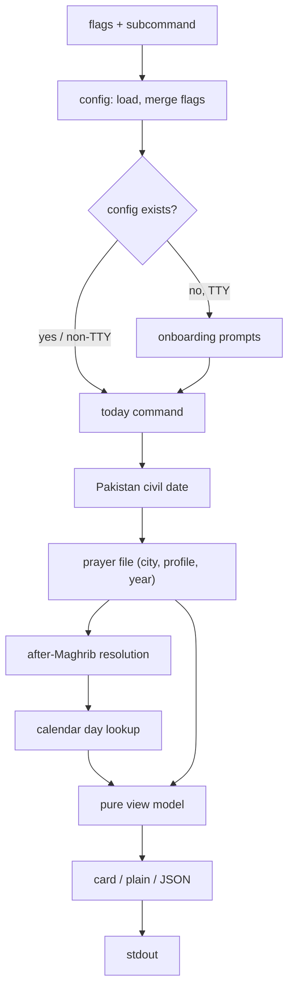

# Architecture

The system overview for `hijri-cli`. Milestone-specific rationale lives in
`specs/<milestone>/design.md`; this document records the stable shape those
milestones share.

## 1. Problem and audience

A Pakistani user wants two things from one command: today's Hijri date and
today's prayer times, including Sehri and Iftar during Ramadan. The dates and
times must be trustworthy, auditable, and honest about uncertainty. The CLI is a
reader of [`hijri-api`](https://github.com/pakistan-hijri/hijri-api), not a second
source of truth.

Goals:

- One command, fast and scriptable, with a useful human card and stable JSON.
- First-run onboarding for city and prayer profile.
- Correct handling of the Islamic day boundary at Maghrib.
- Ramadan-aware Sehri/Iftar and next-event countdown.
- Offline tolerance through a bounded local cache.

Non-goals:

- Computing Hijri dates or prayer times locally.
- Supporting cities or calculation methods the API does not publish.
- A Ramadan month table, status line, or shell completions (milestone 03).
- Accounts, telemetry, or network writes.

## 2. Data source contract

Base URL: `https://pakistan-hijri.github.io/hijri-api`, overridable with
`HIJRI_API_BASE_URL` for local or alternate builds. All routes are `GET` and
serve JSON.

| Route | Purpose |
|---|---|
| `/cities.json` | Onboarding and validation: `id`, `name`, `province`, coordinates, timezone. |
| `/hijri/index.json` | Coverage start, generated time, baseline, available Hijri years. |
| `/hijri/calendar/<hijriYear>.json` | `days[YYYY-MM-DD]` → Hijri date, month names, confidence, optional sources. |
| `/prayer/<city>/<profile>/<gregorianYear>.json` | Metadata, Sehri/Iftar offsets, `days[YYYY-MM-DD].times` as ISO datetimes with `+05:00`. |

Profiles published by the API: `sunni_hanafi`, `sunni_asr1`, `shia_jafari`.
Cities today: `karachi`, `lahore`, `peshawar`, `quetta`. Both lists are treated
as external data: a new city appears in `/cities.json`, and a new profile is a
contract change recorded here before code uses it.

Confidence is part of the contract. `confirmed` means a verified month-start
record exists; `estimated`, `predicted`, and `unconfirmed` are not official. The
CLI surfaces the value; it never upgrades or rewrites it.

## 3. Design principles

1. **Read, don't compute.** All dates and prayer times come from the API. The
   only time arithmetic is comparing instants, adding a day, applying the
   published Sehri/Iftar offsets, and formatting.
2. **Pure core, adapters at the edges.** Resolution and rendering are pure
   functions over typed data plus an injected clock. Network, filesystem,
   prompts, and colour live behind adapters.
3. **Validate once, at the boundary.** Zod parses every external payload. Inward
   code trusts the parsed type.
4. **Uncertainty is visible.** Non-confirmed dates carry a warning in the card
   and the same confidence value in JSON.
5. **Small modules with one reason to change.** The module map in §5 is
   authoritative; new code joins the module that owns its responsibility rather
   than the nearest file.

## 4. Execution flow



The cache sits under the API calls in that diagram: every year file and index is
read through `FileCache`, which can answer from disk or fall through to the
network.

## 5. Module map

```
src/
  cli.ts                 entry point: commander, flags, exit codes, wiring
  commands/
    today.ts             orchestrate data → view → renderer
    setup.ts             run onboarding, persist the result
    config.ts            show/update/clear saved configuration
  config/
    paths.ts             XDG config/cache directory resolution
    config.ts            schema, load/save/clear, defaults
  api/
    http.ts              fetchJson: timeout, retry, response validation
    cache.ts             FileCache: TTL, stale fallback, atomic writes
    cache-key.ts         stable, safe cache filename from a URL
    schema.ts            zod schemas for every external payload
    client.ts            HijriApi: cities, index, calendar, prayer
    year-selection.ts    approximate Hijri year and load fallbacks
  domain/
    profiles.ts          profile ids and labels from the API contract
    calendar.ts          rollover, Hijri year age, date arithmetic helpers
    schedule.ts          prayer list, Sehri/Iftar offsets, next event
    view.ts              assemble the TodayView view model
    types.ts             domain types shared by command/render
  render/
    writer.ts            Writer sink: stdout for results, stderr for diagnostics
    time.ts              ISO → 12/24-hour display, countdown text
    theme.ts             colour decisions, NO_COLOR aware
    today.ts             card and plain renderers
    json.ts              stable JSON payload and JSON error payload
  onboard/
    prompts.ts           city/profile prompts; returns a config patch
    flow.ts              shared onboarding sequence used by today and setup
  errors.ts              CliError and exit-code mapping
  version.ts             package version string
```

Dependency direction:

```
cli → commands → domain
         ↑          ↑
       api       render
         ↑
      config
```

`domain` imports only `domain`, `errors`, and standard library types. It does not
import `api`, `render`, `commander`, `@clack/prompts`, `picocolors`, or `fs`.
`render` imports `domain` types and standard library only. `api` imports
`errors`, `schema`, `http`, `cache`; it does not import `render` or `commander`.

## 6. Date semantics

All civil dates are `YYYY-MM-DD` in `Asia/Karachi`, never the machine timezone.

- **Default convention: after Maghrib.** Before today's Maghrib, the display
  date is the civil date. At or after it, the display date advances one civil
  day. `--midnight` disables the advance.
- **Explicit date:** `--date` is a deterministic civil-day lookup. It ignores the
  current instant and never rolls over; the card states the date it is showing.
- **Cross-year:** a rollover or next-day lookup may cross 31 December. The
  prayer lookup loads the next Gregorian year's file only when needed.
- **Ramadan:** a display day with `month === 9` gets
  `sehriEnds = fajr + sehri_offset_min` and `iftar = maghrib + iftar_offset_min`,
  both from the prayer file. Outside Ramadan the pair is `null`.
- **Next event:** the next instant strictly after `now` among Fajr, Sunrise,
  Dhuhr, Asr, Maghrib, and Isha for the display day. If every instant has
  passed, the next day's Fajr is used, loading the next year's file when
  required. During Ramadan, Fajr is labelled Sehri and Maghrib is labelled
  Iftar.

## 7. Configuration and cache

Config directory precedence:

1. `HIJRI_CLI_CONFIG_DIR`
2. `$XDG_CONFIG_HOME/hijri-cli`
3. `~/.config/hijri-cli`

Cache directory precedence:

1. `HIJRI_CLI_CACHE_DIR`
2. `$XDG_CACHE_HOME/hijri-cli`
3. `~/.cache/hijri-cli`

Config file shape:

```json
{
  "version": 1,
  "city": "karachi",
  "profile": "sunni_hanafi",
  "convention": "after-maghrib",
  "timeFormat": "12h"
}
```

Precedence is **flag > saved config > default**. Defaults are Karachi, Hanafi,
after-Maghrib, 12-hour. A one-off flag never writes the config. `hijri setup`
and `hijri config` do.

Cache files are one JSON envelope per URL, keyed by a SHA-256 hash of the URL.
The envelope carries `url`, `fetchedAt`, and the parsed body. TTLs:

| Data | TTL | Reason |
|---|---|---|
| `/cities.json` | 7 days | Changes rarely. |
| `/hijri/index.json` | 7 days | Coverage metadata changes slowly. |
| `/hijri/calendar/<year>.json` | 12 hours | Confirmations can land after a sighting. |
| `/prayer/<city>/<profile>/<year>.json` | 30 days | Precomputed and stable for the year. |

On network failure the client uses stale cache of any age and reports a warning
on stderr. `--offline` allows only cache reads. `--no-cache` bypasses reads and
writes. A cache write is atomic: write a temporary file in the same directory,
then rename.

## 8. Output contract

One resolved `TodayView` feeds three renderers. TTY gets the card; `--plain`
gets the same content without decoration; `--json` gets the stable payload
described in the README.

- **stdout** carries only the result (card, plain text, or JSON).
- **stderr** carries warnings, progress, and JSON errors.
- **Exit codes:** `0` success, `1` unexpected, `2` usage/validation, `3`
  network or data unavailable, `4` date out of coverage.
- **Colour** is enabled only for a TTY, when `NO_COLOR` is unset and
  `--no-color` was not passed. Confidence and Ramadan labels carry meaning in
  words, so colour is never the only channel.
- **Times** default to 12-hour `h:mm AM/PM`; `--24h` switches to `HH:mm`.
- **Dates** are shown in English plus the API's Urdu month name.
- **Confidence** is always printed. Anything other than `confirmed` says it is
  not an official announcement.
- **Disclaimer:** the card ends with a short calculated-times notice.

## 9. Failure modes

| Failure | Behaviour |
|---|---|
| Network unavailable, fresh cache exists | Serve cache silently if within TTL. |
| Network unavailable, only stale cache exists | Serve stale data and warn on stderr. |
| Network unavailable, no cache | Exit `3` with a message naming the URL host. |
| `--offline` with no cache | Exit `3`; do not attempt the network. |
| Date before `coverage_start` | Exit `4`, naming the coverage start. |
| Date beyond published calendar years | Exit `4`, telling the user data is not published yet. |
| Prayer year not published | Exit `3`, naming the city, profile, and year. |
| Unknown city/profile | Exit `2`; list the accepted values. |
| Invalid API payload | Exit `3`; report the route and validation failure, never print partial data. |
| Corrupt config | Exit `2`; name the file and suggest `hijri config --clear`. |
| Non-TTY with no config | Use defaults; warn on stderr that setup was skipped. |
| Terminal lacks Unicode | Text fallback: ASCII labels and no card rule. |

## 10. Testing strategy

- **Unit tests** cover date arithmetic, rollover, year selection, cache TTL and
  stale fallback, Sehri/Iftar offsets, next-event selection, config precedence,
  and renderers.
- **Fakes at the seams:** a `fetch` function, a clock, temporary directories,
  and a capturing writer. No live network in the suite.
- **Golden files** freeze the card, plain, and JSON output, including a Ramadan
  date and a non-confirmed date.
- **Live smoke** is manual and recorded in `docs/dev-runs/`, never in CI.
- **Coverage is not a target.** A behaviour named in a requirement has a test; a
  line without a behaviour does not need one.

## 11. Dependencies

Runtime: `commander`, `@clack/prompts`, `picocolors`, `zod`. Justifications are
in `specs/style-guide.md` §10. The standard library supplies HTTP, filesystem,
hashing, internationalisation, and date arithmetic; no astronomy, HTTP client,
or date library is added.

## 12. Open decisions

- **OD-00-1 — Onboarding fields.** *Resolved:* city and prayer profile. The
  convention and time format use documented defaults and are changeable through
  `hijri config`.
- **OD-00-2 — Date convention.** *Resolved:* after Maghrib by default;
  `--midnight` opts out.
- **OD-00-3 — Ramadan presentation.** *Resolved:* inline labels on Fajr and
  Maghrib plus a highlighted Sehri/Iftar block.
- **OD-00-4 — MVP scope.** *Resolved:* today's date, prayer times, and next
  event. Month view, status line, and completions are milestone 03.
- **OD-00-5 — Package identity.** *Resolved:* npm package `hijri-cli`, binary
  `hijri`.
- **OD-00-6 — Non-interactive default.** *Resolved:* no prompt when stdin or
  stdout is not a TTY; use defaults and warn on stderr.
- **OD-00-7 — Cache TTLs.** *Resolved:* values in §7. Revisit if confirmations
  start landing more than twice a day.
- **OD-00-8 — Sources on screen.** *Resolved:* source URLs are included in
  `--json` only. The card shows the confidence label; a future `--sources` flag
  can surface links without widening the default output.
